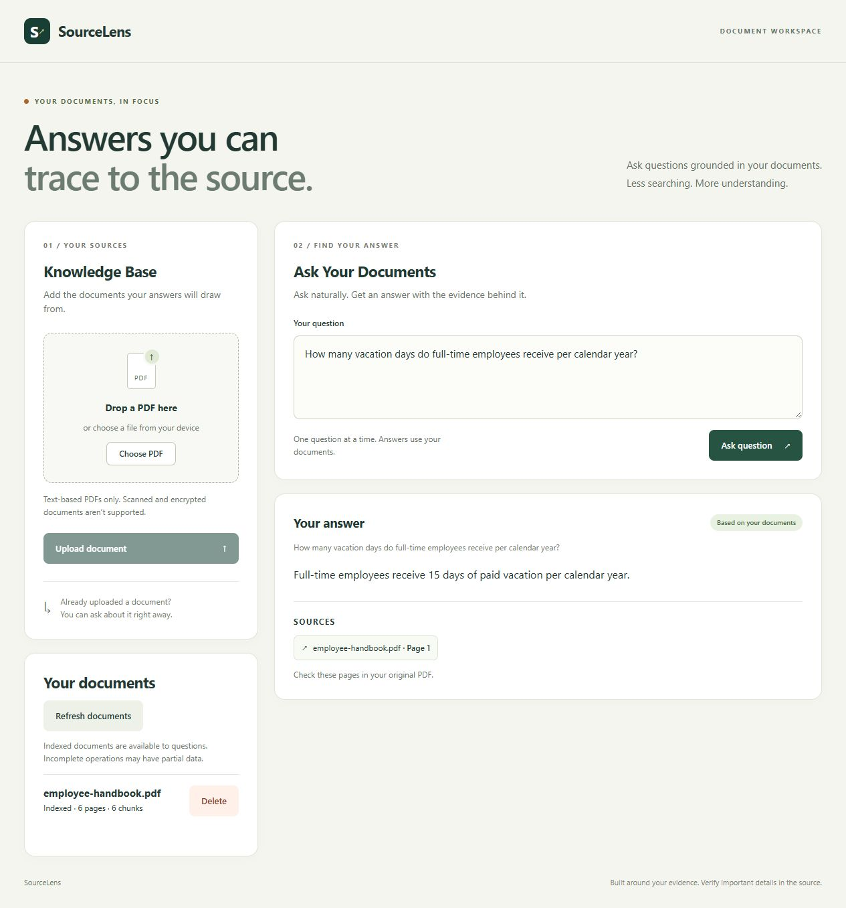
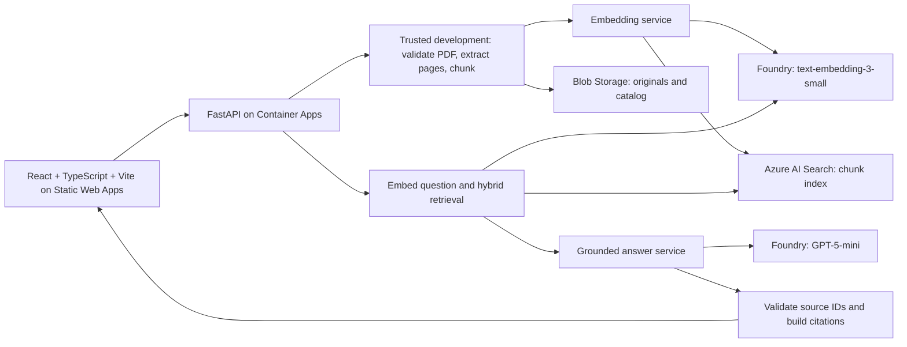

# SourceLens

**AI-powered document Q&A using retrieval-augmented generation (RAG), with grounded answers and page-level citations.**

**[Live Demo](https://ashy-bay-0374e1a0f.2.azurestaticapps.net) · [GitHub Repository](https://github.com/StevenChen2419/SourceLens)**

Finding a policy in a collection of PDFs takes time. A generated answer is only useful if you can check its evidence. SourceLens lets users upload text-based PDFs, ask natural-language questions, and receive answers with document/page citations. When retrieved passages do not support an answer, it returns an insufficient-evidence response.

Built with **Python 3.12, FastAPI, React, TypeScript, Azure AI Search, Azure Blob Storage, and Microsoft Foundry**.

**Deployment:** React on Azure Static Web Apps Free; FastAPI on Azure Container Apps Consumption. Hosted answers, citations, and public-demo restrictions have been verified. Deployment is manual; no CD pipeline is configured.

[Watch the Demo](#watch-the-demo) · [Demo](#demo) · [Features](#technical-features) · [Architecture](#architecture) · [Evaluation](#measured-evaluation-results) · [Security](#scope-and-security) · [Run locally](#run-locally) · [Documentation](#technical-documentation)

## Watch the Demo

**[Watch the portfolio video on YouTube](https://youtu.be/uBj-TnuC2TQ)** to see both the publicly hosted Azure demo and the full local application, including PDF upload, indexing, grounded answers with citations, insufficient-evidence handling, and document deletion in trusted development mode.

## Demo

Upload a PDF in trusted development mode, ask a question, and receive a grounded answer with page-level citations. The screenshot shows that full local workspace; upload and document management are unavailable in the hosted demo.

### Try the live demo

Open the **[live demo](https://ashy-bay-0374e1a0f.2.azurestaticapps.net)**, select an example question, and click **Ask question**. No account is required. Answers use only the preloaded six-page synthetic `employee-handbook.pdf`; inspect the filename and page citations beneath each supported answer. Try the vacation and remote-work questions below, then the Japan question to see insufficient-evidence handling.

The demo does not accept public PDF uploads or allow document deletion. Avoid entering personal information. Cold starts and request limits can cause delays or temporary unavailability.

**Availability:** The live demo uses an Azure Free Trial and may be temporary. The repository, screenshots, and documentation remain available if hosting expires.

### Example outputs

Recorded from the clean `employee-handbook.pdf` demo corpus on October 8, 2026:

| Question | Answer | Citation |
| --- | --- | --- |
| How many vacation days do full-time employees receive per calendar year? | Full-time employees receive 15 days of paid vacation per calendar year. | `employee-handbook.pdf`, page 1 |
| How many days per week may employees work remotely, and whose approval is required? | Employees may work remotely for up to three days per week, with manager approval required. | `employee-handbook.pdf`, page 2 |
| What is the capital of Japan? | The retrieved documents do not contain enough evidence to answer this question. | None; `insufficient_evidence` |

These three questions also passed hosted backend and real-browser smoke tests. Those deployment checks are separate from the reproducible 26-case Azure evaluation, which uses the versioned synthetic evaluation corpus and is reported separately in the [Evaluation section](#measured-evaluation-results) below.

[Recorded demo responses](docs/demo-results.json) · [Reproduce the local demo](docs/development.md#run-the-complete-local-application)

## Technical features

- **Trusted development ingestion:** Extract PDF text page by page, create token-aware chunks within page boundaries, and preserve document/page/chunk metadata. Batch embedding and indexing calls.
- **Hybrid retrieval:** Combine keyword search over chunk text with vector similarity in a single Azure AI Search query. Keep retrieval independently inspectable through `POST /api/retrieval` in trusted development mode.
- **Grounded generation:** Supply retrieved passages to GPT-5-mini, validate returned source IDs, and construct citations from trusted backend metadata. Unsupported questions receive an explicit abstention response.
- **Trusted development document lifecycle:** Detect identical PDF bytes using SHA-256, return duplicate conflicts without re-indexing, list document states, and remove Search chunks before deleting owned originals. A Blob-backed catalog and lease coordinate changes without a database.
- **Evaluation and reliability:** Separate retrieval metrics from generation/citation checks, preserve baseline runs, and use a controlled corpus to investigate duplicate-document effects.
- **Keyless Azure access:** Use Microsoft Entra authentication in the backend, with system-assigned managed identity and scoped RBAC in the deployed backend. Keep Azure credentials out of the frontend.
- **Restricted public demo:** Server-enforced endpoint allowlisting and approved-document filtering serve the synthetic handbook without exposing uploads, deletion, or retrieval diagnostics.
- **Responsive frontend:** React and TypeScript provide upload/document management locally, with suggested questions, loading/error states, answers and citations in the public demo.

Citation validation establishes source provenance; it does not guarantee that every generated claim is semantically supported. That distinction is reflected in the evaluation design.

## Architecture

A modular monolith keeps API routes thin, service orchestration readable, and Azure SDK integrations isolated.

The diagram shows the shared pipeline. Hosted public requests use only the question/retrieval/generation path; ingestion and document management remain trusted development operations. Ingestion confirms embeddings, original storage, and Search indexing before reporting success; it is not an atomic transaction across services. [Failure and recovery behavior](docs/lifecycle.md#states-concurrency-and-failure-behavior)

| Layer | Technology and responsibility |
| --- | --- |
| Frontend | React, TypeScript, Vite on Static Web Apps Free; responsive questions, answers and citations, plus document management in trusted development |
| Backend | Python 3.12, FastAPI, Pydantic on Container Apps Consumption; typed contracts, validation and orchestration |
| PDF processing | pypdf and tiktoken; text extraction and page-bounded token chunks |
| Azure AI Search | Keyword/vector retrieval and chunk metadata; HNSW with cosine similarity |
| Azure OpenAI / Microsoft Foundry | `text-embedding-3-small` with 1,536-dimensional vectors; GPT-5-mini for grounded answers |
| Azure Blob Storage | Private PDF originals and lifecycle catalog for trusted development ingestion/management; public requests need no Blob access |
| Identity | Microsoft Entra via `DefaultAzureCredential`; Azure CLI locally, system-assigned managed identity with scoped RBAC in Azure |
| Quality and packaging | pytest, Vitest, React Testing Library, TypeScript checks; non-root Python Docker image |

The backend runs one Uvicorn worker in a non-root Docker container pinned by immutable image digest, with 0.5 vCPU, 1 GiB RAM and 0–1 replicas. Scale-to-zero reduces idle compute usage; cold starts are expected. No database, agent framework, Kubernetes, or background workers are involved.

## Measured evaluation results

Two live Azure runs used the same **26-case synthetic handbook dataset**: 18 supported questions and 8 unsupported questions across six document sections. Both used `top_k=5` and the same model, chunking, prompt, retrieval and scoring settings.

| Metric | Baseline v1: shared corpus | Controlled Corpus v1: one handbook copy |
| --- | ---: | ---: |
| Retrieval Hit@1 | 83.3% (15/18) | 83.3% (15/18) |
| Retrieval Hit@3 | 88.9% (16/18) | 94.4% (17/18) |
| Expected-page recall in top 5 | 94.4% | 100% |
| Supported / insufficient-evidence classification | 96.2% (25/26) | 100% (26/26) |
| Citation precision against expected sources | 83.3% | 100% |
| Combined citation checks passed | 80.8% (21/26) | 100% (26/26) |
| Deterministic answer checks passed | 96.2% (25/26) | 100% (26/26) |

**Engineering finding:** Isolating one handbook copy improved source selection without ranking or prompt tuning. This motivated content-hash duplicate prevention and explicit document lifecycle management. The remaining Hit@3 miss shows that corpus cleanup did not solve every retrieval-ranking issue.

These are results from a small, controlled synthetic dataset, **not a general accuracy benchmark**. Answer checks use explicit expected facts/patterns and abstention criteria; they do not assess every possible semantic error. Citation metrics measure expected-source matching and provenance, not a guarantee of factual entailment.

[Methodology, limitations and reproduction commands](docs/evaluation.md) · [Versioned dataset](backend/evaluation/handbook.json) · [Published metrics and artifact hashes](docs/evaluation-results.json)

## Run locally

Requires Python 3.12 and Node.js 22.12+ (or 24 LTS). The full application also requires configured Azure resources and an Entra identity with the documented roles. Unit tests mock Azure; live smoke tests and evaluations are separate, explicit commands that consume Azure resources.

1. Follow the [backend setup and configuration](docs/development.md#set-up-the-backend) and [Azure integration configuration](docs/rag.md).
2. Start FastAPI and Vite using the [two-terminal instructions](docs/development.md#run-the-complete-local-application).
3. Open `http://127.0.0.1:5173`. Use `/docs` on the backend to inspect API contracts, including the retrieval debugging endpoint.

Recorded verification: **366 backend tests and 42 frontend tests passed**, plus Docker container verification. The latest frontend deployment passed all 42 frontend tests, TypeScript checks and a production build using the hosted API URL; the final launch review passed 99 focused offline backend security/configuration tests. Test counts are not a code-coverage percentage. [Test commands](docs/development.md#run-tests) · [Container verification](docs/deployment.md#reproducible-packaging-and-local-checks)

## Scope and security

- **Keyless, scoped access:** The deployed managed identity has Search Index Data Reader on the application index and Cognitive Services OpenAI User on the model account. Public requests have no Blob or Search write permissions. Azure credentials remain in the backend, not browser code.
- **Restricted public surface:** Only health, public capabilities and grounded answers are exposed, with appropriate preflights. Upload, listing, deletion, raw retrieval, API docs and unknown routes are blocked server-side. Retrieval enforces the approved document UUID and filename before generation. Production rejects development or unknown modes.
- **Deployment safeguards:** Non-root Docker runtime, immutable image deployment, HTTPS and exact-origin CORS. CORS is a browser policy, not authentication. [Deployment and shutdown procedures](docs/deployment.md)
- **Bounded AI usage:** 500-character questions, 8 KiB bodies, one concurrent answer worker, at most five retrieved chunks, a 2,048-token completion budget, timeouts and no model SDK retries. Rate limits are five admissions/minute per socket peer, 20/minute globally and 100/rolling day within one process.
- **Explicit limitations:** Counters reset on restarts and scale-to-zero; Container Apps proxy peers do not reliably identify individual visitors. Direct and distributed clients can exhaust shared allowances. These controls provide no comprehensive DDoS protection, durable quotas or guaranteed spending cap. Monitor credit and disable access when needed.
- **Portfolio scope:** Anonymous access serves only a fixed synthetic handbook. This is not a production-ready multi-user document SaaS. OCR, user accounts, conversation memory, agents and semantic ranking remain unimplemented. [Future authentication and ownership design](docs/public-access.md)
- **Data handling:** Never commit `.env` or credentials; `VITE_*` values are public. Retrieved documents are untrusted content and must not override application instructions. Blob/Search changes are not transactional; failed lifecycle operations remain visible and retryable. [Recovery and consistency limitations](docs/lifecycle.md)

## Technical documentation

| Guide | Contents |
| --- | --- |
| [Local development](docs/development.md) | Installation, environment configuration, Entra login, local servers, upload checks and tests |
| [RAG implementation](docs/rag.md) | Extraction, chunking, embeddings, Search schema, retrieval, grounding and individual Azure smoke tests |
| [Document lifecycle](docs/lifecycle.md) | Duplicate detection, listing/deletion contracts, consistency, legacy documents and recovery |
| [Evaluation](docs/evaluation.md) | Dataset, metrics, failure diagnosis, controlled-corpus experiment and live evaluation commands |
| [Public access](docs/public-access.md) | Demo isolation, anonymous usage limits and future authentication/ownership requirements |
| [Deployment](docs/deployment.md) | Docker, production settings, HTTPS/CORS, managed identity/RBAC, probes, IP restrictions and manual deployment |
| [Repository instructions](AGENTS.md) | Architecture principles, testing expectations, security rules and milestone boundaries |

Previously named KnowledgeOps. Existing `KNOWLEDGEOPS_*` configuration keys, Azure index names, and synthetic handbook filenames are retained for compatibility.
